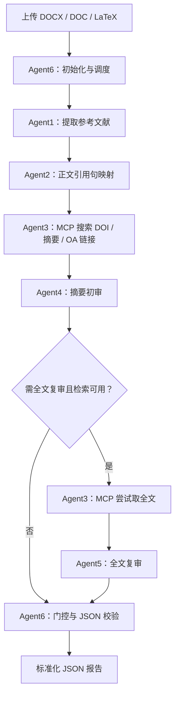

# Agent Research CD：基于 LangGraph / LangChain / MCP 的文献引用证据核验工作流

一个开箱式科研辅助工程：输入 `.docx`、旧版 `.doc` 或 LaTeX `.tex/.latex` 论文，抽取参考文献和正文引用句，查询公开学术元数据及开放获取全文，评估文献是否支持对应判断句，最终生成标准 JSON 报告。

> **重要边界**：这是用于科研筛查和证据定位的辅助工具，不代替研究者阅读原文。置信度是模型给出的估计分数，未经统计校准，不应被解释为严格意义上的真实概率。通过门控也不等于学术事实已被最终证实。

## 1. 工作流与职责

工作流采用 LangGraph `StateGraph` 编排，Agent 由 LangChain 模型调用实现。外部学术检索被集中隔离到 Agent3 所调用的 MCP 文献工具；Agent1、Agent2、Agent4、Agent5、Agent6 不直接访问互联网。

1. **Agent1 — 提取器**：解析输入文件正文和参考文献区，标准化作者、年份、标题、出版源、DOI、BibTeX key 等字段。先用规则识别条目，再由模型协助规范化；解析失败会保留原始文本并给出警告。
2. **Agent2 — 映射器**：从正文中识别作者—年份、数字编号及 LaTeX `\\cite{key}` 引用，将真实出现的引用句与对应参考文献建立配对。原句完整保留，另给出简述和句子类型。若无法建立可靠映射，该参考文献会进入 `unmatched_references`，不会自动编造对应句。
3. **Agent3 — 网络查找器（唯一联网 Agent）**：通过 MCP 工具优先访问参考文献中明确给出的 arXiv/网页 URL，再按 DOI、标题、作者、年份查询 OpenAlex、Crossref，可选 Unpaywall；返回摘要、开放获取状态和可能的 PDF 链接。网页描述不会伪装成论文摘要；全文复核只使用实际取得的 PDF 或网页正文。
4. **Agent4 — 初步审核器**：仅基于判断句、论文元数据和摘要给出置信度、支持关系、摘要证据和局限。
5. **Agent5 — 深入探索器**：初审分数小于或等于阈值，或已找到文献但缺少摘要时，通过 Agent3 尝试全文复审。检索服务故障、模型调用失败不会重复进入全文分支。全文缺失时保留 `confidence: null`，转人工复核。
6. **Agent6 — 调度与门控**：只有完成的审核、有效证据片段、支持/部分支持标签且分数严格大于阈值，才可通过。无法获取资料或无法完成审核为 `manual_required`；完成复审但低于阈值为 `below_threshold`。分数等于阈值会进入复审。所有嵌套报告字段通过 Pydantic 校验。

流程图：



## 2. 快速启动：Docker Compose（推荐）

需要安装 Docker Desktop 或 Docker Engine + Compose。无需本机安装 Python。

1. 解压工程，进入 `agent-research-cd` 目录。
2. 若尚无 `.env`，将 `.env.example` 复制为 `.env`，已有配置请保留。
3. 编辑 `.env`，至少配置以下两种模型选项之一：

   **云端 OpenAI 兼容 API：**
   ```dotenv
   LLM_MODEL=gpt-4o-mini
   LLM_API_KEY=你的_API_Token
   LLM_BASE_URL=
   ```

   **本地 Ollama OpenAI 兼容接口示例：**
   ```dotenv
   LLM_MODEL=qwen2.5:14b
   LLM_API_KEY=ollama
   LLM_BASE_URL=http://host.docker.internal:11434/v1
   ```
   请提前在宿主机启动 Ollama 并拉取对应模型。其他兼容 OpenAI Chat Completions API 的服务也可通过 `LLM_BASE_URL` 接入。填服务的 API 基础路径（通常以 `/v1` 结尾），不要加末尾逗号，也不要填完整 `/chat/completions`。不同模型对长文本、JSON 遵循和工具链以外的能力会有差异。

4. 在工程根目录运行：
   ```bash
   docker compose up --build
   ```
5. 浏览器打开 `http://localhost:8000`，先点“检测模型连接”，通过后上传文件并运行工作流。完成后可下载 JSON。`/health` 只检查 Web 进程；`POST /api/check-model` 会实际请求配置的模型，连接失败时返回具体原因。
6. 停止服务：在终端按 `Ctrl+C`，或执行 `docker compose down`。

结果文件挂载到 `output/` 目录（CLI 运行时使用）；Web 上传结果在页面展示并提供 JSON 下载。`uploads/` 是预留的持久化目录，Web 请求使用临时目录处理上传文件。

### API 使用

启动后，接口为 `POST /api/analyze`，采用 `multipart/form-data`：
- `file`: 文件本体；
- `threshold`: 可选数字，范围 `0–1`，默认来自 `.env`；
- `bib_file`: 可选配套 `.bib` 文件，仅当主文件为 `.tex/.latex` 时使用。

响应体直接是最终 JSON。示例：

```bash
curl -X POST http://localhost:8000/api/analyze \
  -F 'file=@paper.tex' \
  -F 'threshold=0.75' \
  -F 'bib_file=@references.bib' \
  -o report.json
```

## 3. 本机 Python 启动

建议 Python 3.11 或 3.12。旧版 `.doc` 需要本机安装 `antiword` 或 LibreOffice；Windows 可使用 LibreOffice。

### macOS / Linux

```bash
cp .env.example .env
# 编辑 .env，设置 LLM_API_KEY / LLM_BASE_URL
python -m venv .venv
source .venv/bin/activate
pip install -r requirements.txt
```

默认 `MCP_TRANSPORT=stdio`，CLI/Web 会使用当前 Python 自动启动 MCP 子进程，无需单独启动服务。直接运行 `python -m uvicorn app.main:app --host 0.0.0.0 --port 8000` 即可。

如需独立 HTTP MCP 服务，设置 `MCP_TRANSPORT=http` 和 `MCP_URL=http://127.0.0.1:8001/mcp`，再打开两个终端：

终端 A，启动 MCP 文献工具服务：

```bash
python -m app.mcp_server
```

终端 B，启动 Web 界面：

```bash
python -m uvicorn app.main:app --host 0.0.0.0 --port 8000
```

打开 `http://localhost:8000`。

### Windows

可以运行 `scripts\\start_windows.bat` 完成本机环境安装并启动服务；首次使用前先编辑 `.env`。默认 stdio 模式自动启动 MCP 子进程，当前终端运行 Web 界面；HTTP 模式请另行启动 MCP 服务。若虚拟环境或系统策略限制脚本运行，可按上述本机步骤手动执行。

### 附带示例

`examples/sample.tex` 和 `examples/sample.bib` 可用于检查本机 LaTeX/BibTeX 解析。由于示例条目只演示格式，不保证其元数据能在外部服务中匹配，建议将其用于解析冒烟测试，而不是评价支持性分数。

## 4. CLI 用法

默认 stdio 模式直接运行；HTTP 模式需先启动 MCP 服务：

```bash
python -m app.cli paper.docx -o output/report.json --threshold 0.75
```

支持 `.docx`、`.doc`、`.tex`、`.latex`。也可以用模块方式：

```bash
python -m app paper.tex --output output/report.json
```

## 5. LaTeX 文件注意事项

- 对 `\\begin{thebibliography}...\\end{thebibliography}` 和 BibTeX 条目做了直接解析支持。
- 若 `.tex` 中用 `\\bibliography{references}`，请把 `references.bib` 放在同一目录；若文件夹里只有一个 `.bib`，也会尝试自动附加。
- Web 界面支持同时上传一个配套 `.bib` 文件；CLI 则自动读取 `.tex` 同目录的 `.bib` 文件。若主文件引用多个 `.bib`，可在本机 CLI 运行，或将条目合并为一个同名文献库文件。
- 引用匹配覆盖常见作者—年份格式、数字引用 `[1]` 及 LaTeX `\\cite{key}`。特殊引用样式、脚注引用、复杂自定义宏和 OCR 扫描文档可能需要补充解析规则。

## 6. JSON 输出结构

主要字段包括：

- `task_id`, `source_file`, `status`, `threshold`, `model`, `statistics`：任务信息与汇总；
- `references[]`：标准化参考文献，以及 `literature_metadata`（DOI、摘要、开放获取状态、PDF/落地页链接、全文提取状态）；
- `pairs[]`：每组判断句—支持文献配对，包括原句、映射方式、`standardized_response`、`initial_review`、可选 `deep_review` 和 `final_decision`；
- `unmatched_references[]`：正文未找到确定引用句的参考文献；
- `warnings[]` / `errors[]`：检索与处理过程中的问题。

建议下游系统优先使用这些稳定字段：

```json
{
  "pair_id": "PAIR00001",
  "statement_original": "原文中的判断性语句……",
  "reference_id": "REF0001",
  "standardized_response": {
    "judgmental_statement": "原文判断句",
    "supporting_paper": "规范化文献条目",
    "mapping_basis": "作者-年份引用匹配",
    "verification_scope": "仅确认引用对应关系，不等于已验证支持"
  },
  "initial_review": {
    "status": "completed",
    "confidence": 0.68,
    "verdict": "partially_supports",
    "rationale": "..."
  },
  "deep_review": null,
  "final_decision": {
    "passed": false,
    "passed_by": "none",
    "threshold": 0.75,
    "effective_confidence": 0.68,
    "explanation": "..."
  }
}
```

## 7. 学术检索、权限和隐私说明

- 检索源：OpenAlex、Crossref；可选 Unpaywall DOI API（设置 `UNPAYWALL_EMAIL` 后启用）。结果可用性取决于索引覆盖、API 服务状态、DOI 是否正确及文章开放获取政策。并非每条文献都能找到可靠摘要或可访问 PDF。
- `close-source`（`status: close_source`）表示当前元数据明确判断非 OA；`full_text_status` 单独记录全文获取结果。未确认开放状态时为 `metadata_only`，不会自动当成闭源。
- 本工程不会绕过付费墙、登录限制或访问控制。闭源文献只使用可合法取得的元数据/摘要，并明确标注状态。
- 如果全文 PDF 可获取，服务会下载并在内存中提取文本，不会保存原始 PDF。全文文本仅在工作流运行期间使用，不写入输出 JSON；输出中保存全文可用状态、字数和复核所引用的短片段。
- 输入正文和论文片段会发送给你在 `.env` 中配置的模型服务。使用云端 API 时，请确认符合机构的隐私和版权要求；敏感材料建议使用本地模型服务。
- 如需更高可信度，推荐对通过和未通过样本进行人工抽查，并基于目标学科构建人工标注集校准阈值。

## 8. 配置参数

| 参数 | 默认值 | 作用 |
|---|---:|---|
| `CONFIDENCE_THRESHOLD` | `0.75` | 初审/全文复审通过阈值 |
| `MAX_CONCURRENT_LLM_CALLS` | `4` | 并发模型审核数 |
| `MAX_LOOKUP_CONCURRENCY` | `3` | 并发学术检索数 |
| `MAX_PDF_BYTES` | `25000000` | 单篇 PDF 下载上限 |
| `MAX_FULLTEXT_CHARS` | `40000` | 供 Agent5 阅读的全文文本上限 |
| `MIN_FULLTEXT_CHARS` | `1200` | 触发全文复核的最少解析字符数 |
| `MAX_UPLOAD_MB` | `40` | Web 上传限制 |
| `MCP_TRANSPORT` | `stdio` | 本地自动启动 MCP 子进程；Docker 显式使用 `http` |
| `MCP_RETRIES` | `2` | MCP 失败后的重试次数，不含首次调用 |
| `MCP_RETRY_DELAY_SECONDS` | `0.5` | 指数退避起始等待时间 |
| `MCP_TIMEOUT_SECONDS` | `90` | 每次工具发现/调用的总超时 |

## 9. 维护与扩展

- 添加文献元数据源：在 `app/mcp_server.py` 中新增 MCP tool 或扩展 `search_literature`；Agent3 的访问仍保持唯一入口。
- 添加输入格式：在 `app/document_loader.py` 增加解析器，并在 `app/main.py` 中加入后缀白名单。
- 调整支持关系标签、门控或输出字段：分别修改 `app/prompts.py`、`app/workflow.py` 与 `app/schemas.py`。
- 运行离线回归测试：`python -m unittest discover -s tests -v`；安装开发依赖后 `python -m pytest -q` 还会包括原有冒烟测试。
- 回放旧报告的解析：`python scripts/replay_report.py output/research_cd_report.json`。结果在 `output/reference_replay.json`，不包含新的联网核验或置信度，不覆盖原报告。

### JSON 1.2.0 兼容说明

保留 `references`、`pairs`、`initial_review`、`deep_review`、`final_decision` 等字段。不可评估的置信度为 `null`；`failed` 表示所有未通过对数，细分为 `rejected`（完成评估且未通过）与 `manual_required`（无法完成评估）。`statistics.failure_reasons` 汇总具体原因。当所有配对均无法完成审核时，任务状态为 `failed`，不会显示为完成。调用失败不会被表示为 0 分的否定证据。全文过长被截断时提供 `full_text_truncated`。

## 10. 当前版本已知限制

1. 引用句定位主要依靠规则匹配，遇到非标准引用格式时可能漏配；不会为了追求覆盖率而凭空猜测引用句。
2. Agent3 的 OA PDF 发现依赖 arXiv、OpenAlex/Unpaywall 索引与链接；支持引用中明确给出的公开网页，动态网页、登录页面或反爬验证页仍可能无法读取。
3. 一些扫描版 PDF 没有文本层，当前版本不会内置 OCR；这类条目会标注全文解析失败。
4. 旧 `.doc` 的解析依赖操作系统安装的 `antiword` 或 LibreOffice。Docker 镜像已安装这两个工具。
5. 大规模文献库建议后续加入请求缓存、速率限制、持久任务队列和人工复核界面；当前版本面向单篇文档/中等规模参考文献列表。
